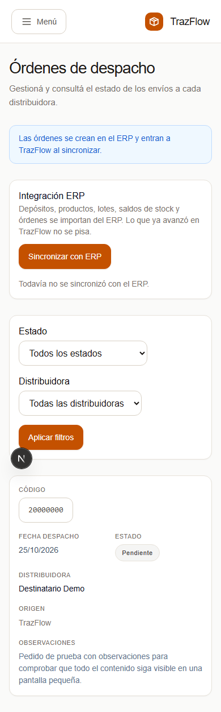
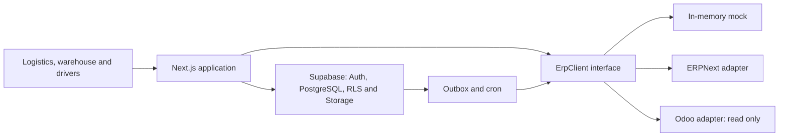

# TrazFlow

[](https://github.com/cataciucci24/TrazFlow-G8/actions/workflows/ci.yml)

TrazFlow tracks the physical flow of pallets from warehouse preparation to delivery. It connects ERP orders and stock with QR scanning, dispatch validation and an auditable history.

[Open the application](https://traz-flow-g8.vercel.app) · [Documentación en español](docs/onboarding.md)

The public application requires an approved account. The demo credentials below belong exclusively to the local seed.



## Current operation

TrazFlow complements the ERP by recording the physical flow of pallets. The visible roles are logistics manager, warehouse operator and driver. Drivers receive assignments per dispatch order and confirm deliveries from **Mis entregas**. Recipients remain business data and do not need accounts.

Pallet labels can be printed individually or in batches from the pallet list. The browser produces an A4 sheet and encodes the persisted pallet code without allowing manual edits.

| Role | Main operations |
| --- | --- |
| Logistics manager | ERP synchronization, order filters, driver assignments, pallet preparation, returns and access approvals |
| Warehouse operator | Pallet preparation, QR scanning, locations, item validation and dispatch confirmation |
| Driver | Assigned deliveries, QR scanning and receipt discrepancies per pallet item |

Pallets may contain several product lots under one QR. Quantities are validated per item and unit. Logistics can return a delivered pallet to its warehouse with a mandatory reason; its delivery history remains available. See [mixed pallets and returns](docs/persona3-pallets.md). Reporting mixed contents to the ERP remains dependent on the adapter/outbox work described there.

Database changes are applied with the Supabase migrations. Existing `distributor_operator` users must be transitioned explicitly by following [`docs/transicion-choferes.md`](docs/transicion-choferes.md).

## ERP integration

The ERP is the source of truth for products, lots, stock and orders. The app talks to it only through the `ErpClient` interface in `src/lib/erp` (`getErpClient(companyId)`), and the provider is chosen with server-only environment variables:

```bash
ERP_PROVIDER=mock            # unset = company works without ERP; "mock", "erpnext" or "odoo" enables the sync
ERP_MOCK_SCENARIO=ok         # mock only: ok | timeout | unauthorized | validation | server_error
ERP_BASE_URL=http://localhost:8080   # erpnext only
ERP_API_KEY=...                      # erpnext only
ERP_API_SECRET=...                   # erpnext only
ERP_TIMEOUT_MS=10000                 # optional
```

The contract (payloads, external ids, error codes, idempotency key and ERPNext setup) is documented in [`docs/erp-contract.md`](docs/erp-contract.md).

### Syncing master data and orders (US-ERP-03)

`ERP_PROVIDER` must be set **explicitly** for the integration to be on (`isErpEnabled` in `src/lib/erp-sync/enabled.ts`). `getErpClient` still falls back to the mock, but an unset variable means "this installation has no ERP": the manual product/lot/pallet forms keep working and the sync action answers with a clear message. Copy [`.env.example`](.env.example) to `.env.local` and set `ERP_PROVIDER=mock` to try the flow:

1. Apply the migrations (`npx supabase db reset` on a local database).
2. Sign in as a logistics manager and open **Pallets**. Under *Integración ERP*, check that `Depósito Central - SRV` is linked to `DEP-01` (the local seed already creates this mapping).
3. Press **Sincronizar con ERP** (also available in **Órdenes**). The panel shows the result and every run is audited in `erp_sync_runs`. Use `ERP_MOCK_SCENARIO=timeout` (or another scenario) to see a failed run: the app stays usable and the error is shown and stored.

What gets imported: warehouses, products, lots, stock balances (lot × warehouse) and open dispatch orders with their product lines, which arrive as drafts. Synchronization does not create physical pallets: users prepare them separately from the available stock. Upserts use company-scoped external identifiers; stock balances use their company/lot/warehouse key. Missing balances become zero, while historical entities and local order progress are retained. With the ERP enabled, manual product, lot and order creation is disabled.

> **An ERP stock balance is not a physical pallet.** Legacy pallets imported before this separation retain their history. New physical pallets have their own contents and TrazFlow QR label.

Details, counters and limitations: [`docs/erp-sync.md`](docs/erp-sync.md).

### Integration panel (US-ERP-05)

Logistics managers get **Integración ERP** (`/dashboard/integrations`): ERP connection status (healthcheck), last sync, dispatched orders not yet reported to the ERP, and a filterable, paginated history of syncs and dispatch reports with sanitized error details. From there they can sync, retry a failed dispatch report (same payload, audited, sent right away) and send due pending reports. `ERP_SYNC_STALE_AFTER_HOURS` (server-only, default 24) sets when the last successful sync is shown as outdated. Badges, permissions, known risks and a manual test checklist: [`docs/erp-integration-panel.md`](docs/erp-integration-panel.md).

## Local development

Use Node 24 (`.nvmrc`); the minimum supported version is 22.12. Supabase requires Node 22+ and the installed Vite requires 22.12+.

Install dependencies with `npm ci` before starting the app or running tests.

Run the app against the **local** Supabase stack (Docker), not the shared cloud database. Syncing with the ERP mock writes data, so never set `ERP_PROVIDER` while pointing at the cloud.

1. Start the stack and build the database from scratch (migrations + [`supabase/seeds/001_demo.sql`](supabase/seeds/001_demo.sql)):

   ```bash
   npx supabase start
   npx supabase db reset
   ```

2. Create `.env.development.local` (git-ignored, read only by `next dev`, takes precedence over `.env.local`) with the values from `npx supabase status`:

   ```bash
   ERP_PROVIDER=mock
   NEXT_PUBLIC_SUPABASE_URL=http://127.0.0.1:54321
   NEXT_PUBLIC_SUPABASE_ANON_KEY=<ANON_KEY or PUBLISHABLE_KEY>
   ```

3. Run `npm run dev` and restart it whenever a `.env*` file changes (Next.js reads them only at startup).

4. Sign in with one of the seeded test users (company **TrazFlow Demo**). These passwords are public and only exist in the local database:

   | Email | Password | Role |
   |---|---|---|
   | `logistica@trazflow.test` | `test1234` | `logistics_manager` |
   | `deposito@trazflow.test` | `test1234` | `warehouse_operator` |
   | `chofer@trazflow.test` | `test1234` | `driver_operator` |

5. The seed loads no ERP data. Sign in as `logistica@trazflow.test` and follow [Syncing master data and orders](#syncing-master-data-and-orders-us-erp-03) (the seed links the mock warehouse to `DEP-01`; press **Sincronizar con ERP**) to import products, lots, pallets and orders from the mock.

Troubleshooting:

- *"La integración con el ERP no está configurada"*: `ERP_PROVIDER` is missing or the dev server was not restarted.
- *"No pudimos cargar esta pantalla"*: the local database is missing migrations. Run `npx supabase migration up --local --include-all`, or `npx supabase db reset` to rebuild it (this erases local data).
- Accounts from the cloud database do not exist locally; use the seeded users above. Mail sent by the local stack (sign-up confirmations) goes to Mailpit at http://127.0.0.1:54324.

## Architecture

The context consists of logistics, warehouse staff and drivers using TrazFlow, with ERPNext/Odoo providing business data. The following container view shows the web app, its managed data services and external integrations. See [architecture views and code links](docs/arquitectura.md).

The browser uses Next.js Server Components and authenticated Server Actions. Supabase provides authentication, PostgreSQL, RLS, RPCs and file storage. ERP reads enter through synchronization; operational writes go through a persistent outbox with idempotency and retries.



The current providers are mock, ERPNext and Odoo. Odoo supports health checks and master-data reads; order reads and write operations are not supported yet. See [Odoo setup and limitations](docs/odoo-deploy.md). Per-company credentials remain pending in TRZ-112. The ERP C4 level 3 is assigned to TRZ-125.

## Onboarding and decisions

See [operator onboarding](docs/onboarding.md), [current roles](docs/modelo-de-roles.md) and [architecture decisions](docs/decisiones/). A recipient is business data; drivers are assigned to dispatch orders, not linked to recipient accounts.

Final sprint review (TRZ-124) must incorporate the remaining company/warehouse features when merged, link the final ERP component diagram (TRZ-125), and include a cross-check by another team member. The public URL was verified to reach the login page; local seeded users are not production demo accounts.

## Team

Names and sprint responsibilities confirmed by the team; responsibilities describe ownership, not completion of every ticket.

| Person | Name | Sprint responsibility |
| --- | --- | --- |
| 1 | Ámbar | Quality, Vitest, CI, ERP contract tests, import tests, HTTPS infrastructure, order filters and documentation |
| 2 | Guille | ERP adapters, Odoo, trip optimization and ERP component architecture |
| 3 | Nai | Shared pallet contents, mixed pallets, validation, reception and returns |
| 4 | Jowi | Warehouses, configurable layouts and location suggestions |
| 5 | Cata | Company onboarding, ERP settings per company, accounts and access requests |
| 6 | Juani | Traceability timelines, delivery documents and exports |
| 7 | Alva | Two-factor authentication, scanner inventory and customer identifiers |

## Testing

Stack: Next.js 16, React 19 and TypeScript; Supabase Auth, PostgreSQL/RLS and Storage; Vitest/V8 for unit and contract tests, and Playwright for browser flows. The real ERPNext runs in Docker on Oracle behind Caddy HTTPS.

Run `npm test` for all unit tests in `src/` and `tests/unit/` (Vitest). Run `npm run test:coverage` for the unified V8 report in `coverage/index.html`, `npm run typecheck` for generated Next route types and TypeScript, and `npm run test:e2e` for browser tests. See [testing and suite selection](docs/testing-demo.md). CI runs lint, type checking, unit tests and a build with dummy Supabase values.
