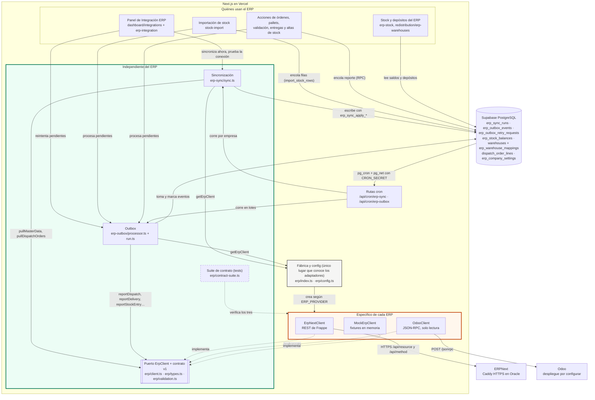
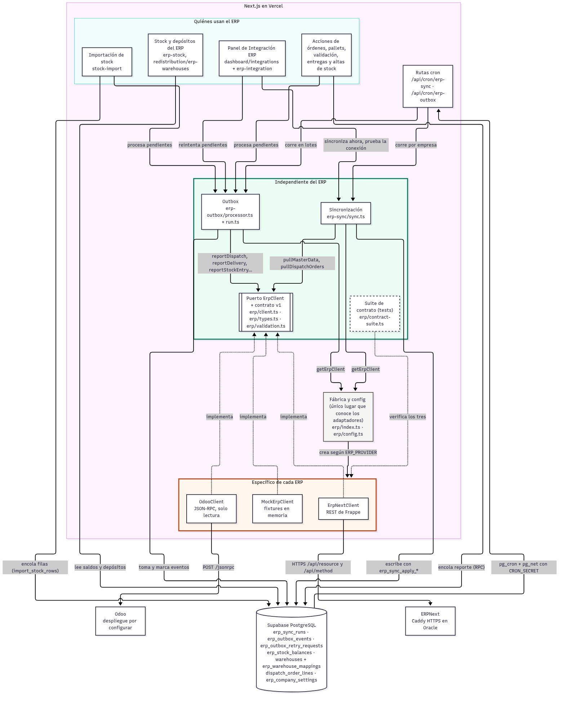

# Arquitectura del módulo ERP: componentes (nivel 3)

Vista de componentes del contenedor "Next.js en Vercel" de la [arquitectura](arquitectura.md) (niveles 1 y 2),
limitada a la integración con el ERP. Código integrado al 23/11/2026 (TRZ-125).

El mensaje principal: casi todo el módulo es **independiente del ERP** y habla solo con el puerto `ErpClient`.
Lo **específico de cada ERP** son los adaptadores; agregar uno no cambia pantallas, sincronización, outbox ni
base de datos.

## Componentes

| Componente | Responsabilidad | Código |
| --- | --- | --- |
| Panel de Integración ERP | Estado, salud, actividad y reintentos de la integración | [página](../src/app/dashboard/integrations/page.tsx), [erp-integration](../src/lib/erp-integration), [componentes](../src/components/erp/integration) |
| Importación de stock | Encola cada fila de la planilla como reporte al ERP | [stock-import/actions.ts](../src/lib/stock-import/actions.ts), [página](../src/app/dashboard/inventory/import/page.tsx) |
| Acciones que encolan reportes | Confirman en la base y procesan el outbox después de responder | [órdenes](../src/lib/orders/actions.ts), [pallets](../src/lib/pallets/actions.ts), [validación](../src/lib/pallet-validation/actions.ts), [entregas](../src/lib/deliveries/actions.ts), [altas de stock](../src/lib/erp-stock/actions.ts) |
| Stock y depósitos del ERP | Leen los saldos y depósitos ya sincronizados (no llaman al ERP) | [erp-stock/queries.ts](../src/lib/erp-stock/queries.ts), [erp-warehouses.ts](../src/lib/redistribution/erp-warehouses.ts), [warehouses](../src/lib/warehouses/queries.ts) |
| Sincronización | Trae depósitos, productos, lotes, stock y órdenes, y los aplica por RPC | [erp-sync](../src/lib/erp-sync), [flujo](erp-sync.md) |
| Outbox | Envía los reportes pendientes con reintentos e idempotencia | [processor.ts](../src/lib/erp-outbox/processor.ts), [run.ts](../src/lib/erp-outbox/run.ts) |
| Rutas cron | Disparadas por pg_cron; validan `CRON_SECRET` y corren sync y outbox | [erp-sync](../src/app/api/cron/erp-sync/route.ts), [erp-outbox](../src/app/api/cron/erp-outbox/route.ts), [jobs](../src/lib/cron) |
| Puerto ErpClient + contrato v1 | Interfaz única, DTOs neutrales, errores y validaciones | [client.ts](../src/lib/erp/client.ts), [types.ts](../src/lib/erp/types.ts), [validation.ts](../src/lib/erp/validation.ts), [contrato](erp-contract.md) |
| Fábrica y config | Único lugar que conoce los adaptadores: lee `ERP_PROVIDER` y las credenciales del servidor y crea el que corresponde | [index.ts](../src/lib/erp/index.ts), [config.ts](../src/lib/erp/config.ts) |
| ErpNextClient | Adaptador REST de ERPNext/Frappe | [erpnext-client.ts](../src/lib/erp/erpnext-client.ts), [despliegue](erpnext-deploy.md), [Caddy](../infra/erpnext/Caddyfile.production) |
| OdooClient | Adaptador JSON-RPC de Odoo, solo lectura | [odoo-client.ts](../src/lib/erp/odoo-client.ts), [Odoo local](odoo-deploy.md), [docker-compose](../infra/odoo/docker-compose.yml) |
| MockErpClient | ERP simulado para desarrollo y tests | [mock-client.ts](../src/lib/erp/mock-client.ts), [fixtures.ts](../src/lib/erp/fixtures.ts) |
| Suite de contrato (tests) | Código de test: los mismos casos para los tres adaptadores, no corre en producción | [contract-suite.ts](../src/lib/erp/contract-suite.ts), [contract.test.ts](../src/lib/erp/contract.test.ts) |
| Tablas ERP | Corridas, outbox, saldos, depósitos, líneas de orden y política de lotes | [migraciones](../supabase/migrations), [pg_cron](../supabase/migrations/20261030110000_trz104_pg_cron_jobs.sql) |

## Cómo se suma un ERP

Un ERP nuevo es un archivo `src/lib/erp/<erp>-client.ts` que implementa `ErpClient`. **El único cambio fuera del
adaptador es en la fábrica:** un `case` en `createErpClient` (`index.ts`) y la variante de config (el tipo
`ErpConfig` y su lectura en `readErpConfig`, más el valor nuevo en `ERP_PROVIDERS`). En los tests se registra en la
suite de contrato, marcando lo que no soporte. No se tocan pantallas, acciones, sincronización, outbox, rutas cron
ni tablas: todo eso solo conoce `ErpClient` y el contrato v1. Hoy el proveedor se elige por variables del servidor
(`ERP_PROVIDER` y credenciales, nunca con `NEXT_PUBLIC_`) y es el mismo para todas las empresas; elegir el ERP por
empresa depende de TRZ-112.
