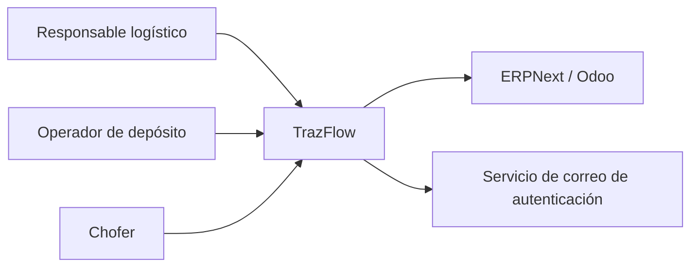
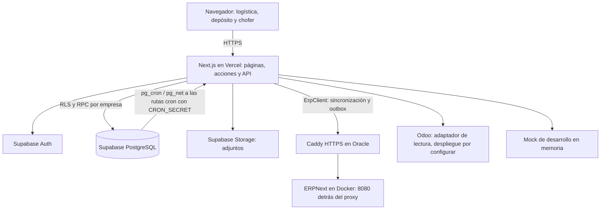

# Arquitectura actual: contexto y contenedores

Vistas del código integrado al 23/11/2026. El proveedor sigue configurado por
variables del servidor; el ERP por empresa depende de TRZ-112.

## Contexto (nivel 1)

TrazFlow registra el recorrido físico de pallets y sus ítems. El ERP proporciona
catálogo, saldos y órdenes. Los destinatarios son datos comerciales; no tienen
cuenta propia. Odoo actualmente solo implementa salud y datos maestros.

## Contenedores (nivel 2)

La IP reservada y el certificado del ERPNext se documentan en
[despliegue](erpnext-deploy.md). El puerto 8080 no acepta tráfico público en Oracle.
La app registra reportes pendientes en un outbox persistido; los cron y las
acciones los procesan con reintentos e idempotencia.

## Rutas para revisar el diseño

| Responsabilidad | Código / documentación |
| --- | --- |
| Puerto y tipos neutrales | [client.ts](../src/lib/erp/client.ts), [types.ts](../src/lib/erp/types.ts) |
| Selección del proveedor | [index.ts](../src/lib/erp/index.ts), [config.ts](../src/lib/erp/config.ts) |
| Sincronización | [erp-sync](../src/lib/erp-sync), [flujo](erp-sync.md) |
| Outbox | [processor.ts](../src/lib/erp-outbox/processor.ts) |
| Cron | [erp-sync](../src/app/api/cron/erp-sync/route.ts), [erp-outbox](../src/app/api/cron/erp-outbox/route.ts) |
| Contenido físico del pallet | [contents.ts](../src/lib/pallets/contents.ts), [pallets mixtos](persona3-pallets.md) |
| Reglas de acceso | [modelo de roles](modelo-de-roles.md), migraciones RLS/RPC en [supabase](../supabase/migrations) |
| Contrato y tests compartidos | [contrato](erp-contract.md), [contract-suite.ts](../src/lib/erp/contract-suite.ts) |

El diagrama de componentes del módulo ERP, nivel 3 con fuente e imagen, corresponde
a Guille en TRZ-125 y todavía no está en develop. Enlazar aquí su entrega al integrarla.
